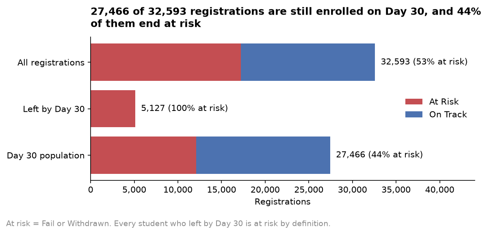
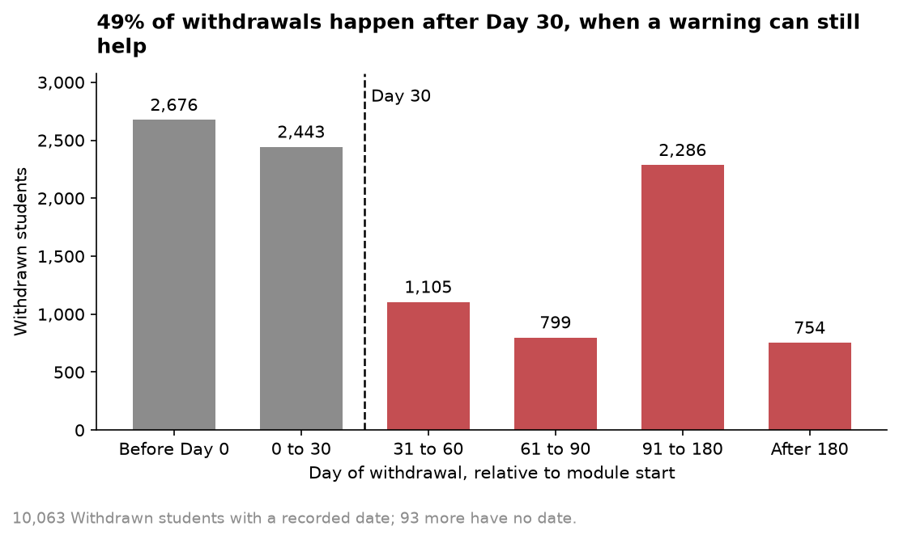
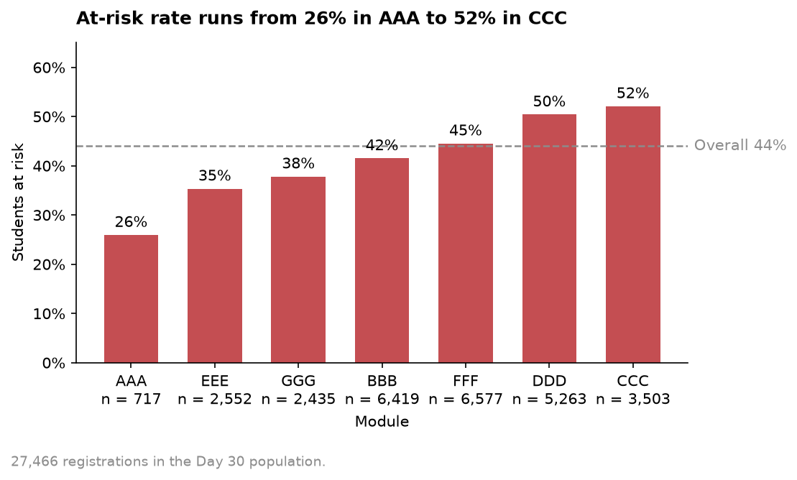
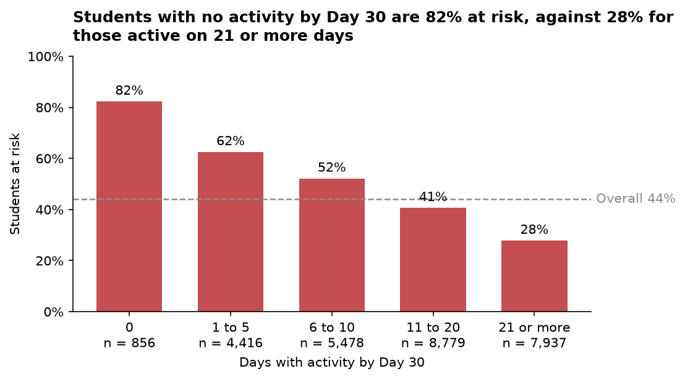
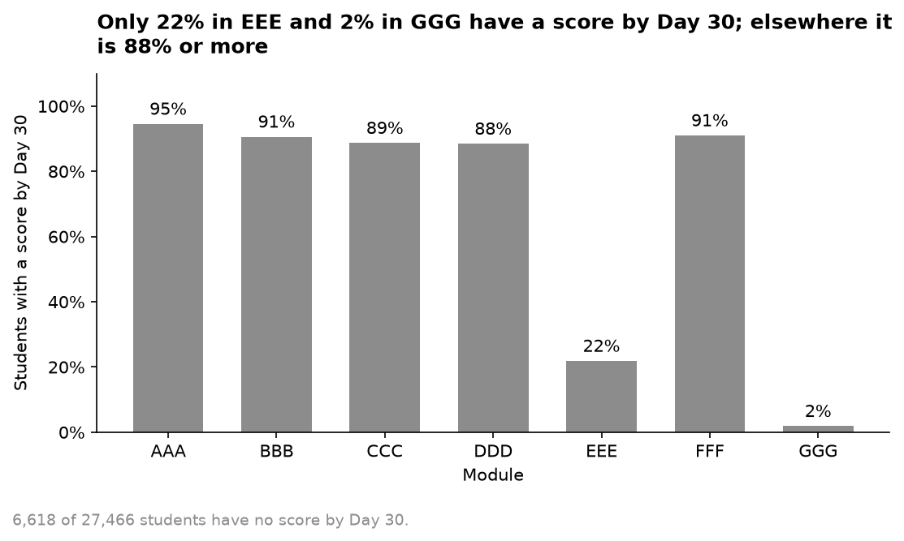
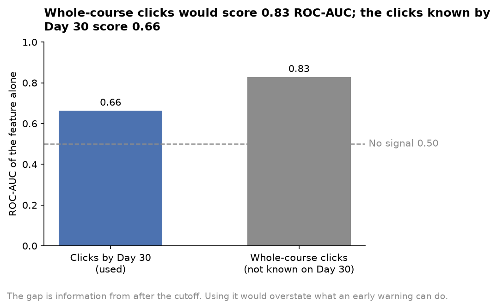

# Student Academic Risk Early Warning and Intervention Recommender

**Day 30 early warning system on the Open University Learning Analytics Dataset**

Submitted as part of the AI/ML Internship, TrackGenesis (ICT Academy of Kerala)

Team 8: Sruthi G S, Ancy Michael, Abhijith M S, Gouri M, Midhula M

Submission date: 30 October 2026

---

# 1. PROJECT OVERVIEW

## 1.1 Introduction

Universities and distance-learning providers lose a large share of their students to failure and withdrawal. Many of these students show early signs of difficulty: they log in rarely, miss their first assessment or stop working on the course for long stretches. Support teams can act on those signs only if they see them in time and know which students to contact first.

This project builds an early warning system that scores every enrolled student on Day 30 of a module, using only the records available on that day. The system ranks students by calibrated risk, explains each score in plain language, suggests a type of support and summarises risk by module for a support team. It is delivered as a Python package, a set of reproducible scripts, an automated test suite and a five-page Streamlit application.

The work uses the Open University Learning Analytics Dataset (OULAD), a public and anonymised dataset that records both online engagement and final outcomes for the same students. All results in this report are produced by the code in the project repository and read from its committed result files.

## 1.2 Problem Statement

Students at risk of failing or withdrawing need help early, while there is still time to change the outcome. In OULAD, 52.8% of all module registrations end in Fail or Withdrawn, and 49% of withdrawals with a recorded date happen after Day 30 of the module (Figure 2). A warning issued on Day 30 therefore reaches about half of the students who later withdraw while they are still enrolled.

The warning signs are visible early. Students with no online activity by Day 30 end at risk in 82% of cases, against 28% for students active on 21 or more days (Figure 4).

Staff capacity is limited. A support team can contact only a fixed number of students in a week, so the system has to answer a practical question: given the capacity available, which students should be contacted first, why, and with what kind of support?

# 2. PROJECT IDEA AND OBJECTIVES

## 2.1 Project Idea

The system fixes a prediction day, Day 30 of each module presentation, and builds every input from records dated on or before that day. A Random Forest scores each student, an isotonic calibrator turns the score into a calibrated risk score, and the cohort is ranked by that score. A support team chooses its contact capacity (for example the highest-risk 20% of the cohort) and receives a ranked list.

For each flagged student, SHAP contributions identify the inputs that raise and lower the score. A sentence names the main reasons, and a rule-based recommender maps those reasons to one of five support types: tutoring, peer tutoring, mentoring, weekly check-ins and financial aid referral. Aggregated tables describe risk by module, the retention funnel and engagement profiles of the cohort.

Protected characteristics (gender, region, highest education, deprivation band, age band and disability) are excluded from the model inputs, and the effect of this choice on accuracy and on group outcomes is measured and reported.

## 2.2 Practical Example

*Hypothetical example. The student, module and values below are invented for illustration and describe no real OULAD record.*

A student registers for a module two weeks before it starts. By Day 30 the student has been active on the module website on three days, the last of them in the second week, and has missed the first assessment, which was due in week three. The student is studying a second module at the same time.

On Day 30 the support team opens the application with a capacity of 20%. The student appears in the High band near the top of the ranked list. The Student page gives the reasons: a long spell without activity before Day 30, a missed assessment and few active days. A ring shows the observed outcome of the High band in this module in the validation presentation: the share of those students who went on to fail or withdraw, a group statistic rather than a personal probability. The suggested support is weekly check-ins, with mentoring as an alternative, and the page describes what similar students from earlier presentations looked like on Day 30.

A tutor contacts the student in the following week. The decision to contact, and the form of the contact, remain with the tutor; the application supports that judgment.

## 2.3 Project Objectives

1. Build a leakage-safe Day 30 dataset from the seven OULAD tables, with a documented population, target and feature set.
2. Validate the model in time order: train on earlier presentations and validate on the latest one, with students present in both sets removed from training.
3. Train and compare a logistic regression baseline, a Random Forest and XGBoost, and select a final model on recall-oriented measures.
4. Exclude the six protected characteristics from the inputs and measure the cost in accuracy and the remaining gaps between groups.
5. Calibrate the risk score and choose all cutoffs on out-of-fold training scores, so the validation presentation is used for evaluation only.
6. Flag students by contact capacity and report precision, recall and lift at each capacity level.
7. Explain each student's score with SHAP and a plain-language sentence, and suggest support with a transparent rule-based recommender.
8. Produce aggregated team tables: risk by module, a retention funnel and student engagement profiles, with small groups suppressed.
9. Deliver a Streamlit application that shows the validation presentation by default and labels in-sample results.
10. Make the work reproducible from a fresh clone, with automated tests for leakage, data handling, the model, the tables, the documentation and the application.

# 3. DATASET DESCRIPTION AND PREPROCESSING

## 3.1 Dataset Description

The Open University Learning Analytics Dataset (OULAD) describes students on seven modules (AAA to GGG) over four presentations: 2013B, 2013J, 2014B and 2014J. A presentation is one run of a module. The dataset has seven tables:

| Table | Content |
|---|---|
| courses | modules, presentations and their length |
| assessments | assessments per module presentation, with type, due date and weight |
| vle | online learning resources (VLE sites) |
| studentInfo | one row per registration, with demographics and the final result |
| studentRegistration | registration and unregistration dates |
| studentAssessment | submissions, submission dates and scores |
| studentVle | daily click counts per student and VLE site |

The dataset holds 32,593 module registrations (enrolments) from 28,785 unique students, and 10,655,280 rows of daily VLE activity. The final result is Pass for 12,361 registrations, Withdrawn for 10,156, Fail for 7,052 and Distinction for 3,024.

Licence and citation, as stated under "Rights statement and License" on the dataset's page (https://research.stem.open.ac.uk/ouanalyse/open-dataset-more/):

- License: "This dataset is released under CC-BY 4.0 license." The licence link on that page is https://creativecommons.org/licenses/by/4.0/.
- Citing the dataset: "When citing the dataset please use the following reference:" Kuzilek J., Hlosta M., Zdrahal Z. Open University Learning Analytics dataset Sci. Data 4:170171 doi: 10.1038/sdata.2017.171 (2017).

The raw data is kept outside the repository. Only aggregated figures derived from it are committed.

## 3.2 Day 30 Population and Target

The unit of prediction is one module registration, identified by module, presentation and student. The target `at_risk` is 1 when the final result is Fail or Withdrawn and 0 when it is Pass or Distinction.

Students who unregistered on or before Day 30 cannot be warned on Day 30, so they are excluded from modelling and kept for the retention funnel. Of the 32,593 registrations, 5,127 unregistered on or before Day 30, and every one of them is at risk by definition. The model population is the remaining 27,466 registrations, of which 44.0% are at risk (Figure 1). This population includes 16 students who registered after Day 30.



*Figure 1. Registrations, early leavers and the Day 30 population, with the at-risk share of each. Data: OULAD, all registrations in the four presentations 2013B, 2013J, 2014B and 2014J.*



*Figure 2. Withdrawn students by day of withdrawal relative to the module start, with Day 30 marked. Data: OULAD, Withdrawn students with a recorded date in the four presentations 2013B to 2014J.*

The at-risk share in the Day 30 population differs between presentations and between modules:

| Presentation | Day 30 population | At-risk share |
|---|---:|---:|
| 2013B | 4,111 | 0.490 |
| 2013J | 7,655 | 0.415 |
| 2014B | 6,497 | 0.483 |
| 2014J | 9,203 | 0.407 |



*Figure 3. At-risk rate by module against the overall rate. Data: OULAD, Day 30 population of the four presentations 2013B to 2014J.*

## 3.3 Features

The final model uses 24 inputs, each computed from records dated on or before Day 30.

| Group | Inputs |
|---|---|
| Engagement (9) | total clicks, active days, clicks per active day, clicks in the last 7 days, clicks in the previous 7 days, click trend, first active day, longest run of inactive days, inactive days just before Day 30 |
| Submissions and scores (5) | assessments submitted, assessments missed, mean score, weighted score, score trend |
| Timing (2) | late submissions, mean submission delay in days |
| Registration (4) | registration lead time, registered late, registered after Day 30, registration date missing |
| Study load and history (2) | credits studied, previous attempts |
| Course context (2) | module, assessments due by Day 30 |

Exams are excluded from the assessment features because they take place at the end of a module. Missing values are imputed inside the model pipeline, with imputers fitted on the training rows.



*Figure 4. At-risk rate by the number of days with VLE activity up to Day 30. Data: OULAD, Day 30 population of the four presentations 2013B to 2014J.*

The six protected characteristics in OULAD (gender, region, highest education, deprivation band, age band and disability) are excluded from the inputs. An ablation compares the final model with the same Random Forest trained on all 30 inputs, using the same split and procedure:

| Model | ROC-AUC | PR-AUC | Precision at 20% capacity | Recall at 20% capacity |
|---|---:|---:|---:|---:|
| Final model, 24 inputs | 0.766 | 0.721 | 0.800 | 0.393 |
| Random Forest, 30 inputs | 0.775 | 0.733 | 0.801 | 0.393 |

On 1,000 paired bootstrap resamples of the validation presentation (seed 42), the 30-input model is ahead by 0.0087 in ROC-AUC (95% interval 0.0054 to 0.0124) and by 0.0116 in PR-AUC (95% interval 0.0075 to 0.0153). The difference is small and consistent across resamples. At the operating point used by the application, the highest-risk 20% of the cohort, the two models have the same recall and precision within 0.001. The project accepts this small loss in ranking quality in exchange for a model whose scores and explanations never draw on a protected characteristic.

## 3.4 Split and Leakage Controls

**Temporal split.** The model is trained on the three earlier presentations (2013B, 2013J and 2014B) and validated on the latest one (2014J). A new presentation is scored with a model trained on past ones, and the validation follows the same direction in time.

**Students in both sets.** Some students register in more than one presentation. In the Day 30 population, 1,258 students appear both in a training presentation and in 2014J. Their 1,348 training rows are removed, which reduces the training set from 18,263 to 16,915 rows. The validation set keeps all 9,203 rows of 2014J.

**Leakage tests.** The leakage checklist in the repository lists the rules every feature must meet. The automated tests enforce them in three ways:

- The leakage test runs each feature builder twice, once on the data and once on the same data with every record dated after Day 30 altered, and requires identical output. The output must also contain no `final_result`, `date_unregistration` or `at_risk` column.
- The engagement and assessment tests add records after Day 30, or change scores submitted after Day 30, and require the features to stay the same.
- A rebuild test loads the saved model through a hash-checked loader, scores 2014J in the application's ranking code and requires the flagged counts, precision and recall at every capacity level to match the committed `metrics.json`. The loader refuses a model file whose SHA-256 hash differs from the one recorded in `config.json`.

The calibrator and every cutoff come from out-of-fold scores on the training presentations (GroupKFold by presentation), and the explainer and the similar-student pool use training data only.

**Clicks after Day 30.** Figure 6 shows the size of the information gap the cutoff protects against. Clicks counted up to Day 30 rank students with ROC-AUC 0.66; clicks over the whole course would give 0.83. Using whole-course activity would overstate what an early warning can do.

**Score release timing.** OULAD records when work was submitted, and the dataset holds no date on which a score was released to the student or the tutor. A score counted on Day 30 may therefore have been unknown to staff on that day. This limit applies to the score inputs and is listed in Section 6.



*Figure 5. Share of students in each module with at least one assessment score by Day 30. Data: OULAD, Day 30 population of the four presentations 2013B to 2014J.*



*Figure 6. ROC-AUC of total clicks used alone, counted up to Day 30 and over the whole course. Data: OULAD, Day 30 population of the four presentations 2013B to 2014J.*

## 3.5 Models and Calibration

**Logistic regression baseline.** The Review 1 baseline is a logistic regression on 30 inputs (the 24 final inputs and the six protected characteristics). On 2014J it reaches ROC-AUC 0.733 and PR-AUC 0.625.

**Random Forest and XGBoost.** The comparison of tree models was carried out in the tuning notebook contributed by Midhula M (`notebooks/xgboost-random-forest (2).ipynb`, with a later version in `notebooks/xgboost-random-forest (4).ipynb`). On the same split and 30 inputs, at a threshold of 0.5 on 2014J, the notebook reports:

| Model | Recall | Precision | PR-AUC | ROC-AUC |
|---|---:|---:|---:|---:|
| Logistic regression baseline | 0.626 | 0.632 | 0.625 | 0.733 |
| Random Forest | 0.635 | 0.650 | 0.730 | 0.773 |
| XGBoost | 0.668 | 0.624 | 0.708 | 0.763 |

The notebook's selection rule keeps the models whose recall is at least the baseline's and chooses the one with the highest PR-AUC, which selected the Random Forest. Its hyperparameters were then tuned with RandomizedSearchCV over 20 candidates and 3 folds grouped by presentation, scored on PR-AUC. The best configuration reached a mean cross-validated PR-AUC of 0.7845 (standard deviation 0.0481 across folds).

**Final configuration.** The final model is a Random Forest on the 24 inputs, with the tuned hyperparameters recorded in `models/final/config.json`:

| Parameter | Value |
|---|---|
| n_estimators | 234 |
| max_depth | None (trees grow until the leaf limits apply) |
| max_features | sqrt |
| min_samples_split | 20 |
| min_samples_leaf | 5 |
| class_weight | balanced_subsample |
| random seed | 42 |

**Isotonic calibration.** A Random Forest score ranks students well but is a poor estimate of probability. Out-of-fold scores are produced for every training row by GroupKFold by presentation, so each row is scored by a model that never saw its presentation. An isotonic regression is fitted on these out-of-fold scores and the true outcomes, and it maps the final model's raw score to a calibrated risk score. Calibration is monotonic: it changes the scale and leaves the ranking unchanged. On the out-of-fold training scores, calibration reduces the Brier score from 0.190 to 0.187.

## 3.6 Operating Point and Capacity

**Why a capacity ranking.** At-risk prevalence differs between presentations, from 0.407 to 0.490. A cutoff fixed in advance therefore flags a different share of each new cohort. In the leave-one-presentation-out runs, the top_20 cutoff flagged between 17.2% and 28.6% of the held-out presentation. A support team works with a fixed number of contacts, so the application ranks the cohort by calibrated risk and flags the highest-risk share the team can contact. Ties in the calibrated score are broken by the raw forest score.

**Capacity table.** Results of flagging the top share of 2014J (9,203 students, at-risk prevalence 0.407):

| Flagged share | Students | Precision | Recall | Lift |
|---:|---:|---:|---:|---:|
| 5% | 460 | 0.948 | 0.116 | 2.33 |
| 10% | 920 | 0.893 | 0.219 | 2.20 |
| 15% | 1,380 | 0.850 | 0.313 | 2.09 |
| 20% | 1,841 | 0.800 | 0.393 | 1.96 |
| 25% | 2,301 | 0.752 | 0.462 | 1.85 |
| 30% | 2,761 | 0.709 | 0.522 | 1.74 |
| 40% | 3,681 | 0.637 | 0.626 | 1.56 |
| 50% | 4,602 | 0.588 | 0.723 | 1.45 |

At the default capacity of 20%, eight in ten flagged students go on to fail or withdraw, and the list reaches 39% of all at-risk students in the cohort.

**Wide-net cutoff.** For a team that wants broad coverage, the wide-net rule flags everyone at or above a calibrated score of 0.333. This is the score at which out-of-fold recall on the training presentations reaches 0.80 (0.802, with 60.1% of training students flagged). On 2014J the wide net flags 57.3% of students with recall 0.778 and precision 0.552.

**Cutoffs and bands.** All cutoffs are chosen on calibrated out-of-fold training scores, and 2014J is never used to choose them:

| Cutoff | Rule on out-of-fold training scores | Calibrated score |
|---|---|---:|
| top_10 | top 10% of scores | 0.866 |
| top_20 | top 20% of scores | 0.650 |
| top_30 | top 30% of scores | 0.579 |
| wide_net | recall of at least 0.80 | 0.333 |

Three risk bands start at two of these cutoffs: Low below 0.333, Medium from 0.333 to below 0.650, and High from 0.650. The application shows each student's band and rank; the calibrated score appears only under the Student page's "Why this score" tab.

**What the bands mean.** Observed outcomes of each band in 2014J:

| Band | Share of 2014J students | Observed at-risk rate | Lift |
|---|---:|---:|---:|
| Low | 43% | 0.212 | 0.52 |
| Medium | 40% | 0.434 | 1.07 |
| High | 17% | 0.827 | 2.03 |

Lift is the band's at-risk rate divided by the rate of all 2014J students (0.407). The High band identifies students with about twice the cohort's at-risk rate, and the Low band about half. The Medium band's rate is close to the cohort average, so a Medium band on its own is a weak signal, as the application's About page states.

## 3.7 Evaluation

**Validation metrics.** On 2014J (9,203 students, at-risk prevalence 0.407), with 95% intervals from 1,000 bootstrap resamples (seed 42):

| Measure | Value | 95% interval |
|---|---:|---|
| ROC-AUC | 0.766 | 0.756 to 0.776 |
| PR-AUC | 0.721 | 0.707 to 0.735 |
| Precision at the top_20 cutoff | 0.827 | 0.808 to 0.846 |
| Recall at the top_20 cutoff | 0.350 | 0.335 to 0.365 |

The PR-AUC reference level, the score of a random ranking, is the prevalence of 0.407.

**Calibration.** Calibration on 2014J:

| Measure | Raw score | Calibrated score |
|---|---:|---:|
| Brier score | 0.191 | 0.188 |
| Expected calibration error (10 bins) | 0.058 | 0.026 |

The reliability table for the calibrated score on 2014J compares the mean calibrated score in each bin with the observed at-risk rate:

| Calibrated score bin | Students | Mean calibrated score | Observed at-risk rate |
|---|---:|---:|---:|
| 0.0 to 0.1 | 20 | 0.015 | 0.100 |
| 0.1 to 0.2 | 1,867 | 0.159 | 0.136 |
| 0.2 to 0.3 | 1,643 | 0.270 | 0.271 |
| 0.3 to 0.4 | 1,509 | 0.368 | 0.329 |
| 0.4 to 0.5 | 1,331 | 0.454 | 0.415 |
| 0.5 to 0.6 | 854 | 0.562 | 0.514 |
| 0.6 to 0.7 | 694 | 0.642 | 0.641 |
| 0.7 to 0.8 | 318 | 0.743 | 0.786 |
| 0.8 to 0.9 | 311 | 0.840 | 0.810 |
| 0.9 to 1.0 | 656 | 0.953 | 0.927 |

**Stability across presentations.** The whole configuration (model, calibrator and cutoffs) was refitted four times, each time holding out one presentation:

| Held out | Prevalence | ROC-AUC | PR-AUC | top_20 flagged | top_20 precision | top_20 recall | wide_net recall |
|---|---:|---:|---:|---:|---:|---:|---:|
| 2013B | 0.490 | 0.801 | 0.817 | 23.2% | 0.879 | 0.415 | 0.837 |
| 2013J | 0.415 | 0.766 | 0.725 | 18.7% | 0.811 | 0.366 | 0.783 |
| 2014B | 0.483 | 0.781 | 0.789 | 28.6% | 0.818 | 0.484 | 0.821 |
| 2014J | 0.407 | 0.766 | 0.721 | 17.2% | 0.827 | 0.350 | 0.778 |

ROC-AUC ranges from 0.766 to 0.801 and precision at the top_20 cutoff from 0.811 to 0.879. The 2014J figures are at the lower end of this range, and the share flagged by a fixed cutoff varies with prevalence, as described in Section 3.6.

**Comparison with simpler approaches.** Ranking students by Day 30 clicks alone gives ROC-AUC 0.66 (Figure 6). This figure covers the Day 30 population of all four presentations, so it is an indicative comparison and not a like-for-like comparison with the 2014J results below. The logistic regression baseline reaches ROC-AUC 0.733 and PR-AUC 0.625 on 2014J. At 20% capacity, its precision is 0.676 and its recall 0.332, against 0.800 and 0.393 for the final model. For a team contacting 1,841 students, the final model's list contains 0.800 × 1,841 ≈ 1,472 at-risk students, against about 1,244 for the baseline.

**Recall by module.** With 20% capacity applied across the whole 2014J cohort, recall within each module is:

| Module | Students | Flagged | At-risk rate | Recall | Precision |
|---|---:|---:|---:|---:|---:|
| AAA | 348 | 43 | 0.273 | 0.326 | 0.721 |
| BBB | 1,786 | 186 | 0.355 | 0.226 | 0.769 |
| CCC | 2,014 | 568 | 0.496 | 0.480 | 0.845 |
| DDD | 1,463 | 431 | 0.459 | 0.516 | 0.803 |
| EEE | 1,020 | 152 | 0.329 | 0.351 | 0.776 |
| FFF | 1,857 | 382 | 0.398 | 0.401 | 0.777 |
| GGG | 715 | 79 | 0.379 | 0.210 | 0.722 |
| All modules | 9,203 | 1,841 | 0.407 | 0.393 | 0.800 |

GGG (0.210) and BBB (0.226) have the lowest recall. A cohort-wide ranking concentrates contacts in modules with higher scores, so the application also offers capacity applied to each module separately.

**Source of the additional figures.** The paired bootstrap difference in Section 3.3 and the recall by module above are not stored in `metrics.json`. They were computed for this report with the repository's own code on the committed final model: the paired bootstrap uses the same fitting and scoring functions and the same resampling settings as `metrics.json` (1,000 resamples, seed 42), and refitting the 30-input model reproduced its ROC-AUC in `metrics.json` exactly. The recall by module uses the application's capacity ranking, which reproduces the committed capacity table, and involves no random sampling.

## 3.8 Fairness Audit

Protected characteristics are read from the data for this audit only. At the top_20 cutoff on 2014J, recall and flag rate by gender and age band are:

| Group | Students | At risk | Flag rate | Recall |
|---|---:|---:|---:|---:|
| Gender F | 3,872 | 1,488 | 12.9% | 0.280 |
| Gender M | 5,331 | 2,258 | 20.4% | 0.396 |
| Age band 35 to 55 | 2,811 | 1,057 | 12.7% | 0.293 |
| Age band up to 35 | 6,305 | 2,658 | 19.3% | 0.373 |

Gaps, with 95% intervals from 1,000 bootstrap resamples (seed 42):

| Gap | Point | 95% interval |
|---|---:|---|
| Recall, female minus male | -0.116 | -0.147 to -0.086 |
| Flag rate, female minus male | -0.075 | -0.089 to -0.059 |
| Recall, age 35 to 55 minus up to 35 | -0.080 | -0.112 to -0.045 |
| Flag rate, age 35 to 55 minus up to 35 | -0.066 | -0.080 to -0.049 |

All four intervals exclude zero. At the same cutoff, the model reaches a smaller share of at-risk women than of at-risk men, and a smaller share of at-risk older students than of younger ones.

These gaps are measured on the final model, which has none of the protected characteristics as inputs. Removing the inputs therefore leaves the gaps in place: other inputs, such as activity patterns, module choice and credits studied, are associated with gender and age, and the model's ranking reflects those associations.

No group-specific thresholds were applied. Setting a different cutoff for each group would require using a protected characteristic in the decision for each student, which the project's design excludes, and the audit covers one validation presentation, which is too narrow a basis for a policy change. The gaps are reported in the documentation and on the application's About page, so a support team can take them into account when it reviews the list.

## 3.9 Explanations and Recommender

**SHAP explanations.** Each student's raw forest score is explained with `shap.TreeExplainer` in tree_path_dependent mode, which takes the expected score from the training data stored in the trees, so no validation data reaches the explainer. Contributions are checked to add up to the raw score within 1e-6. One-hot columns are summed back into their input, so the module counts as one contribution. Because calibration is monotonic, it changes the scale of the score and leaves the direction of each contribution unchanged.

The 24 inputs fall into three explanation groups. Behaviour inputs (activity, inactivity, submissions, scores, delays, missed work and registration timing) and study inputs (previous attempts and credits studied) can be named as reasons. Course inputs (module and assessments due) are described as course-level patterns about the module. Protected characteristics have no contribution because they are excluded from the model.

**Plain-language sentences.** A sentence names the student's risk band and at most three inputs that raise the score and two that lower it. It names one input per idea (average score and weighted score count once), and each named input must move the score by at least 0.005. Sentences state the band and leave the score out. The calibrated score appears once, under the Student page's "Why this score" tab, with the note that it is calibrated across all modules. An automated test checks, for a sample of students, that no protected characteristic appears as an input, a driver, a phrase, a chart label or a word in the text.

**Rule-based support suggestions.** Only actionable inputs, those a support contact can respond to, drive a suggestion. Of the 24 inputs, 21 are actionable; the module, assessments due and previous attempts are excluded. Each actionable input maps to one or two of five support types with weights that sum to 1:

| Support type | Matched from |
|---|---|
| Tutoring | low or falling scores, missed or unsubmitted work |
| Peer tutoring | low scores, low site activity |
| Mentoring | inactivity, late work, registration timing, credits studied |
| Weekly check-ins | site activity, inactivity, missed work, late work |
| Financial aid referral | registration timing, credits studied |

A support type's match score is the sum of weight times contribution over the inputs that raise the student's score, and the top three are suggested. Financial aid referral is matched from workload and registration timing only, never from the deprivation band. On 2014J at 20% capacity, weekly check-ins are the primary suggestion for 1,211 of the 1,841 flagged students (66%), because many engagement inputs map to them.

**Similar students.** Each suggestion is shown with context from the 50 most similar students of the same module in the training presentations, matched on Day 30 activity, assessment and study-load inputs. The application shows how many of them ended at risk or on track, and hides any group of fewer than 10 students. The pool refuses 2014J, so a validation student's outcome can never reach a suggestion.

**Limitation.** OULAD records no interventions and no outcomes of support. The mapping from reasons to support types is a documented assumption for staff to review, and the similar-student figures describe past students. Neither is evidence that a type of support works.

## 3.10 Team Tables

Three aggregated tables summarise the cohort for a support team. They are built by one script, kept out of version control as generated data, and summarised in the tracked file `reports/team_tables.json`.

**Department (module) risk.** OULAD organises teaching into modules, so a department view is one module in one presentation. For 2014J:

| Module | Students | At-risk rate | Low | Medium | High |
|---|---:|---:|---:|---:|---:|
| AAA | 348 | 27% | 57% | 31% | 12% |
| BBB | 1,786 | 36% | 37% | 55% | 8% |
| CCC | 2,014 | 50% | 41% | 34% | 25% |
| DDD | 1,463 | 46% | 38% | 36% | 26% |
| EEE | 1,020 | 33% | 50% | 36% | 14% |
| FFF | 1,857 | 40% | 45% | 38% | 17% |
| GGG | 715 | 38% | 49% | 44% | 8% |
| All modules | 9,203 | 41% | 43% | 40% | 17% |

**Retention funnel.** A retrospective view with six nested stages. Stages 1 to 4 use data available on Day 30; stages 5 and 6 use final outcomes and describe what happened afterwards.

| Stage | 2013B | 2013J | 2014B | 2014J |
|---|---:|---:|---:|---:|
| Registered | 4,684 (100%) | 8,845 (100%) | 7,804 (100%) | 11,260 (100%) |
| Still registered after Day 30 | 4,111 (88%) | 7,655 (87%) | 6,497 (83%) | 9,203 (82%) |
| Active in the VLE by Day 30 | 3,984 (85%) | 7,372 (83%) | 6,272 (80%) | 8,982 (80%) |
| Met the Day 30 submission check | 3,660 (78%) | 6,898 (78%) | 5,764 (74%) | 8,466 (75%) |
| Did not withdraw | 3,048 (65%) | 5,925 (67%) | 4,711 (60%) | 7,015 (62%) |
| Passed | 2,077 (44%) | 4,346 (49%) | 3,286 (42%) | 5,351 (48%) |

The submission check counts students who submitted at least one non-exam assessment by Day 30, or who had none due. In EEE (2013J, 2014B, 2014J) and GGG (2013J, 2014B, 2014J) no assessment is due by Day 30, so the stage would measure the course schedule rather than the student. It is marked not applicable there and the previous count is carried forward, also in the totals above.

**Student profiles.** KMeans clusters of five Day 30 engagement and submission features: total clicks (log-transformed), active days, inactive days just before Day 30, assessments submitted and assessments missed. No protected characteristic, assessment score or outcome is a clustering input. The scaler and clusters are fitted on the training presentations, and validation students are assigned to the nearest cluster. The number of clusters is the k from 3 to 5 with the highest silhouette score on a fixed sample of 10,000 training rows:

| k | Silhouette | Smallest cluster (share of training rows) |
|---:|---:|---:|
| 3 | 0.335 | 14% |
| 4 | 0.365 | 7% |
| 5 | 0.346 | 7% |

With k = 4, the profiles in 2014J are:

| Profile | 2014J students | Share | Observed at-risk rate | Mean clicks | Mean active days | Mean missed |
|---|---:|---:|---:|---:|---:|---:|
| Moderately engaged | 5,008 | 54% | 43% | 194 | 10.3 | 0.00 |
| Highly engaged | 3,186 | 35% | 25% | 749 | 27.1 | 0.00 |
| Little VLE activity | 537 | 6% | 73% | 12 | 1.3 | 0.28 |
| Missed early assessment | 472 | 5% | 86% | 142 | 7.7 | 1.00 |

The at-risk rate is attached after clustering and plays no part in it. The profile features were chosen to give interpretable engagement groups: in an earlier trial, a lateness feature (`n_late`) produced a single-purpose cluster defined by late submission alone. Profile names are assigned by rules on the cluster centres.

**Small-group suppression.** Every row is a group of students and no table holds a student identifier; the application refuses any team table with an `id_student` column. A group with fewer than 20 students, or a funnel count from 1 to 19, is kept with its figures blank. In the funnel, enough further modules are hidden that the "All modules" total cannot reveal a hidden count. In the current tables no row needed to be hidden.

## 3.11 The Application

The Streamlit application is organised around a tutor's workflow: see who to contact first, understand one student, then look at the cohort. It serves on the local machine only, because it shows individual student records.

| Page | What it shows |
|---|---|
| Overview | Four summary cards (students in view, flagged for contact, precision and at-risk reached); a donut of the Low, Medium and High bands; the main reasons behind flags; and the ranked list of flagged students with module, band, a Day 30 snapshot, main reason and suggested support. The list downloads as CSV. |
| Student | Example buttons and selectors for module and student ID. A header card with the student ID, module and presentation, the band and the rank in the module, and a ring labelled "Observed outcome for this band": the share of 2014J students in the same band and module whose final result was Fail or Withdrawn, with n. This is a group statistic rather than a personal probability. Four tabs: Overview (the verdict and primary suggestion), Day 30 indicators (six indicators compared with the module median), Why this score (the inputs that raise and lower the raw forest score, and the calibrated score, shown only here) and Support (the suggestions with similar-student context). |
| Modules | One card per module with its at-risk rate and band shares; band shares by module; at-risk rate by intake and by active days; the student profiles; the retention funnel; and, in collapsed sections, the data tables and the calibration chart for 2014J. |
| Support | One card per support type with its definition and the number of flagged students for whom it is the primary suggestion; charts of the counts overall and by module; and a note that suggestions are rule-based and that OULAD has no intervention records. |
| About | The model, the design and validation, the risk bands and how to read them, capacity flagging, limitations (including the lowest module recalls and the group recall gaps), the OULAD licence and citation, and the rebuild commands. |

**Validation by default.** The application opens on 2014J, the validation presentation. A training presentation is offered only after the user turns on "Show training presentations (in-sample scores)" under Advanced. It is then labelled as in-sample in the presentation list, in a sidebar warning, on the cards and in every exported table, and the precision and recall cards read "Not shown", because in-sample scores are optimistic.

**Display rules.** A student's risk is shown as a band and a rank; the calibrated score appears only under "Why this score". Student identifiers appear only in the Overview list and on the Student page, and they are the pseudonymised identifiers published with OULAD. The Student header card carries the sentence "This is a model prediction. It supports, and does not replace, professional judgment."

**Screenshots.** Figures 7 to 11 show the application on the validation presentation, 2014J. The Overview page is shown with all modules and a contact capacity of 20%.

*Figure 7. Overview page, 2014J (validation): summary cards, risk distribution and main reasons behind flags.*

*Figure 8. Student page, Overview tab, 2014J (validation): header card with band, rank in module and the observed outcome ring for the band, followed by the verdict and primary suggestion. The student ID is a pseudonymised OULAD identifier.*

*Figure 9. Student page, Why this score tab, 2014J (validation): inputs that raise the raw forest score and the calibrated score, calibrated across all modules.*

*Figure 10. Modules page, module cards, 2014J (validation): observed at-risk rate, number of students and band shares for each module.*

*Figure 11. Modules page, charts, 2014J (validation): observed at-risk rate by days active by Day 30 and by student profile.*

**Performance.** The application caches the data, model, explainer and similar-student pool once, and caches scores per presentation. SHAP takes about 0.25 s per student on one core, so `scripts/precompute_shap.py` computes the validation presentation's explanations in advance; the ranked list and Student page read them, checked against the model file's hash. Training the final configuration, including the comparison models, the bootstrap and the leave-one-presentation-out runs, took 53.0 s in the run recorded in `models/final/config.json`.

## 3.12 Testing and Reproducibility

**Tests.** The suite has 211 tests in 24 test files, and all 211 pass (run time 205.94 s). They cover:

- data loading, cleaning, the target and the Day 30 population;
- the engagement, assessment and registration features, including the leakage tests;
- the temporal split and the removal of students in both sets;
- the baseline, the Random Forest and the final model, including cutoffs that grow stricter in order and the rebuild test against the committed capacity table;
- SHAP explanations, factor wording and the absence of protected characteristics from every output;
- the support mapping, the similar-student pool and the recommender;
- the scoring service, priority list, figures and team tables, including small-group suppression;
- the documentation, which must match `config.json`, `metrics.json` and `team_tables.json` and quote the OULAD licence and citation exactly;
- the application, run headless on synthetic data, with no data, with a model, with precomputed explanations, with a training presentation and with valid, student-level and incomplete team tables.

**Rebuild from a fresh clone.** From the README and `docs/app.md`:

```
git clone https://github.com/SruthiGS-Gito/sar-ai-early-warning-intervention-recommender.git
cd sar-ai-early-warning-intervention-recommender
python -m venv .sar-env
.sar-env\Scripts\activate          # Windows
# source .sar-env/bin/activate     # macOS or Linux
pip install -r requirements.txt
pip install -e .
# place the seven OULAD CSV files in data/raw/
python scripts/make_interim.py
python scripts/run_baseline.py
python scripts/train_final.py
python scripts/precompute_shap.py    # optional
python scripts/build_team_tables.py
pytest
streamlit run app/streamlit_app.py
```

**What is committed.** The repository holds the source package, scripts, tests, notebooks, documentation, the aggregated figures, the final model's `config.json` and `metrics.json` (with the SHA-256 hashes of the model files and the feature matrix) and `reports/team_tables.json`. Raw, interim and processed data, model binaries, precomputed SHAP values and any student-level output stay outside version control. The model binaries are rebuilt by `scripts/train_final.py` and verified against the recorded hashes when loaded.

# 4. TEAM CONTRIBUTIONS

Contributions below follow the Review 1 sprint scope (`docs/review1_scope.md`) and the repository's commit history.

**Sruthi G S**
- Review 1 tasks: development environment and GitHub repository (102), backlog and sprint planning in Jira (115), Day 30 cutoff and validation split (109), leakage checklist and automated cutoff test (110), engagement and registration features (213), and sprint ceremonies and the Friday review (101).
- Repository: set up the package structure and contribution guidelines, and integrated the Review 1 modules into the `sar` package with tests and documentation; Day 30 insights notebook (`164_SGS_day30_insights.ipynb`) and the exported charts in `reports/figures/`.
- After Review 1: SHAP explanations (`215_SGS_shap_explanations.ipynb`), the intervention recommender (`216_SGS_intervention_recommender.ipynb`) and the final model, team tables and application described below.

**Ancy Michael**
- Review 1 tasks: project kickoff and brief analysis (113), grade and outcome distribution charts (106), and attendance and assignment patterns across departments (205).
- Repository: the notebook `206_AM_indicator_combinations.ipynb`, covering data preparation, grade distribution charts, engagement and submission patterns across modules, a retention funnel analysis by presentation, department risk charts and an analysis of at-risk indicator combinations.

**Abhijith M S**
- Review 1 tasks: download of OULAD and first inspection (114), loader for the seven tables (103), cleaning of student data and join-key checks (104), dataset choice and proxy decisions (105), and processed tables for the dashboard and funnel (202).
- Repository: data preparation notebooks, including an earlier retention funnel analysis notebook (since removed from the repository) and the first version of the data notebook `student_academic_risk.ipynb`.

**Gouri M**
- Review 1 tasks: engagement metrics up to Day 30 (107), consecutive inactive days (108), engagement-by-outcome charts (116) and withdrawal timing analysis (204).
- Repository: the engagement profile notebook (`Engagement profile charts and export.ipynb`), which clusters Day 30 engagement with KMeans and compares cluster counts by silhouette and inertia, and an engagement clustering section added to `student_academic_risk.ipynb`.

**Midhula M S**
- Review 1 tasks: target definition and Day 30 population (111), assessment features (211) and the baseline logistic regression model (112).
- Repository: the Random Forest and XGBoost tuning notebook (`xgboost-random-forest (2).ipynb`, with a later version `xgboost-random-forest (4).ipynb`), which compares both models with the baseline, selects the Random Forest and tunes the hyperparameters used in the final model, together with its description in `notebooks/README.md`.

**Integration after Review 1.** After Review 1, the remaining integration was completed by Sruthi G S with the agreement of the team: the final model, calibration, explanations, recommender, team tables, application, tests and documentation. Teammates' notebooks served as references for this work: the Random Forest and XGBoost tuning notebook (Midhula M) for the model choice and hyperparameters; the retention funnel analysis in notebook 206 (Ancy Michael) for the funnel stages; the engagement profile notebook (Gouri M) for the profile features and the range of cluster counts; and the data notebook `student_academic_risk.ipynb` (Abhijith M S and Gouri M) for the data preparation steps.

# 5. PROJECT LINK AND REFERENCES

**Project repository:** https://github.com/SruthiGS-Gito/sar-ai-early-warning-intervention-recommender

**Dataset:** Kuzilek J., Hlosta M., Zdrahal Z. Open University Learning Analytics dataset Sci. Data 4:170171 doi: 10.1038/sdata.2017.171 (2017). Released under CC-BY 4.0 (https://creativecommons.org/licenses/by/4.0/).

**Libraries.** Version requirements from `requirements.txt`, with the versions recorded for the final model run in `models/final/config.json` where available:

| Library | Requirement | Recorded in the final model run |
|---|---|---|
| Python | 3.10 or later (`pyproject.toml`) | 3.12.10 |
| pandas | 2.0 or later | 3.0.6 |
| NumPy | 1.24 or later | 2.5.3 |
| scikit-learn | 1.3 or later | 1.9.1 |
| matplotlib | 3.7 or later | |
| Plotly | 7.1.0 | |
| PyArrow | 14.0 or later | |
| Jupyter | 1.0 or later | |
| pytest | 7.4 or later | |
| SHAP | 0.54.1 | |
| Streamlit | 1.66.0 | |

# 6. CONCLUSION AND LIMITATIONS

## 6.1 Conclusion

The project delivers a Day 30 early warning system for OULAD that is leakage-safe, calibrated and organised around a support team's capacity. On the 2014J validation presentation, the final Random Forest reaches ROC-AUC 0.766 (95% interval 0.756 to 0.776) and PR-AUC 0.721 without any protected characteristic as input. Flagging the highest-risk 20% of the cohort gives a list in which eight in ten students go on to fail or withdraw, reaching 39% of all at-risk students. Each flag comes with a band, a plain-language reason and a rule-based support suggestion, and the application presents the results at student, module and cohort level. The work is reproducible from a fresh clone and covered by 211 automated tests.

## 6.2 Limitations

- **Validation set.** 2014J is a validation presentation and served earlier to compare model configurations. Its figures may therefore be slightly optimistic. The leave-one-presentation-out results show the spread across presentations.
- **Rule-based recommender.** OULAD records no interventions, so the support mapping is an assumption and the effect of any support is unknown.
- **Group recall gaps.** At the same cutoff, recall is lower for women than for men and for students aged 35 to 55 than for younger students, with intervals that exclude zero.
- **Missing early scores.** In EEE and GGG no assessment is due by Day 30, so the model has no early score for most of these students.
- **Calibration across all modules.** The calibrator is fitted on all modules together, so a calibrated score can be higher or lower than the observed rate within a single module.
- **Score release timing.** OULAD holds no date on which a score was released, so a score counted on Day 30 may have been unknown to staff on that day.
- **One dataset and one institution.** All results come from one distance-learning institution and four presentations, and may transfer differently to other settings.

## 6.3 Future Work

1. **Record and evaluate interventions.** Log which students are contacted, with what support and with what outcome, so the recommender can be tested and the effect of each support type estimated.
2. **Confirm results on a new presentation and reduce group gaps.** Score a presentation that played no part in model development, and test approaches that narrow the recall gaps by gender and age, such as per-module capacity or additional engagement inputs, while keeping protected characteristics out of individual decisions.
3. **Use release-dated scores and module-level calibration.** With access to score release dates and more presentations per module, restrict score inputs to results known on Day 30 and fit calibration per module where the data allows.
